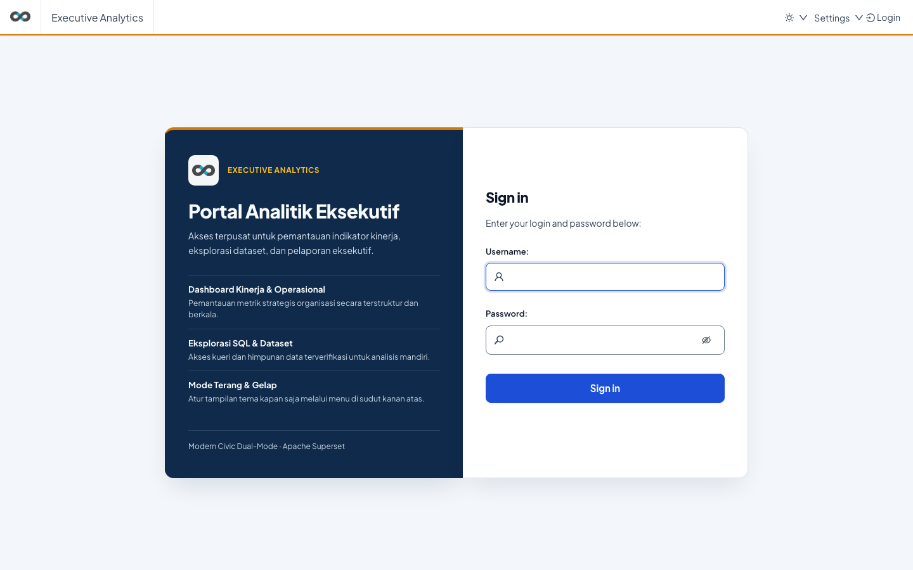
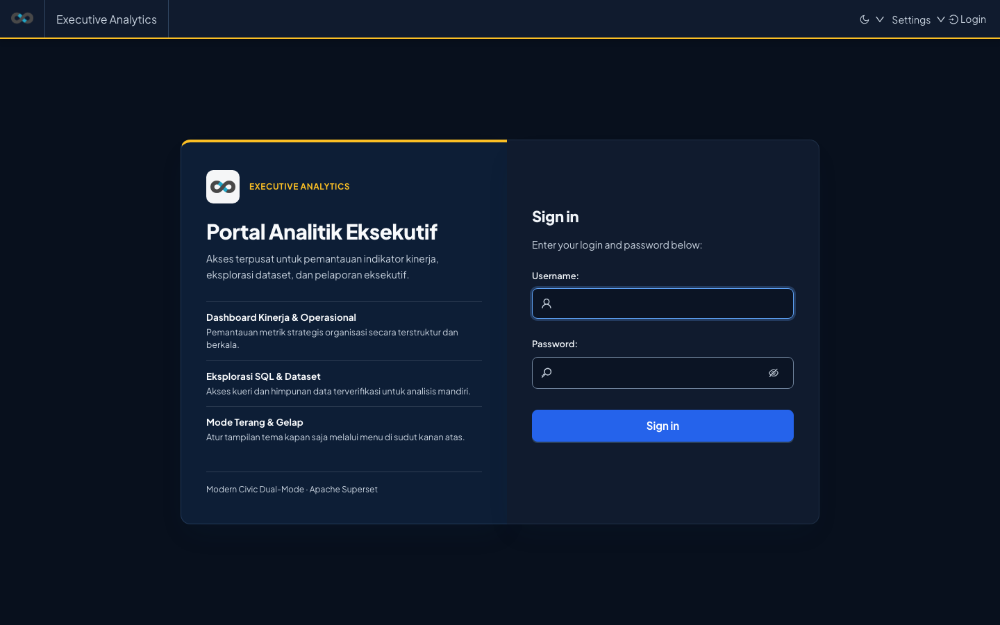
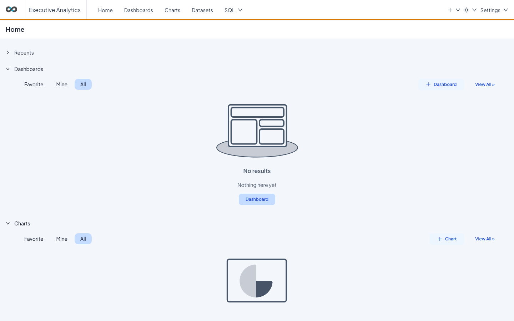
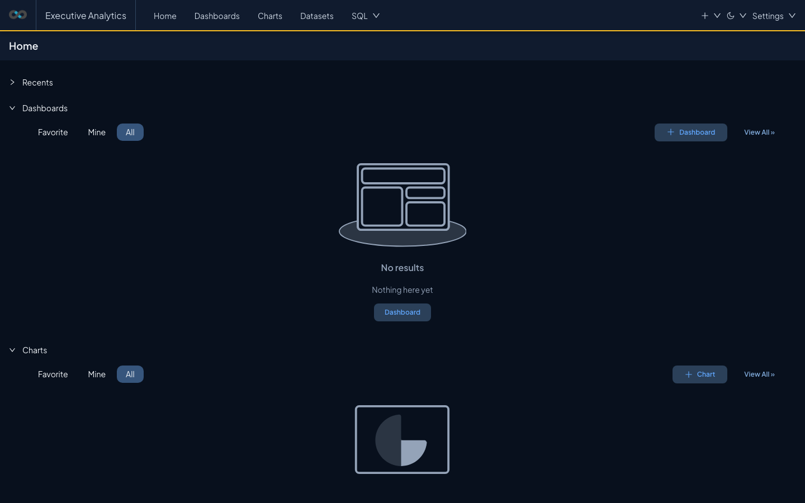

# Template Konfigurasi & Tema Apache Superset 6.1.0 — Modern Civic Dual-Mode v3

Repositori ini ditujukan **khusus untuk konfigurasi dan tema UI (`Modern Civic Dual-Mode v3`)** beserta stack Docker Compose untuk **Apache Superset 6.1.0**. Repositori ini sengaja disimpan dalam keadaan **bersih**: **tanpa logo instansi, dashboard, chart, dump database, kredensial, maupun contoh bawaan (`SUPERSET_LOAD_EXAMPLES=no`)**.

Tag rilis template: `v3-civic-dual-20261124`

## Pratinjau Tampilan

### Tampilan Awal (Login)

| Mode Terang (Light) | Mode Gelap (Dark) |
| :---: | :---: |
|  |  |

> Tampilan login menggunakan layout **Split-Screen Civic Eksekutif** dengan panel identitas di sisi kiri, kartu login di sisi kanan, responsif bertumpuk di tablet/mobile, serta memakai logo bawaan **Apache Superset** (`/static/assets/images/favicon.png`).

### Tampilan Utama (Home)

| Mode Terang (Light) | Mode Gelap (Dark) |
| :---: | :---: |
|  |  |

> Halaman **Home** (`/superset/welcome/`) tampil kosong secara default (`SUPERSET_LOAD_EXAMPLES=no`) dengan branding generik `Executive Analytics` dan ikon bawaan yang bebas diganti sesuai kebutuhan Anda.

## Ringkasan Fitur & Tampilan

1. **Tema Modern Civic Dual-Mode v3 (`superset_config.py`, `modern-executive-theme.css`, `spa.html`)**
   - Mendukung penuh mode terang (`THEME_DEFAULT`, latar `#f3f6fa`/`#ffffff`, aksen `#1d4ed8`) dan mode gelap (`THEME_DARK`, latar `#08101d`/`#101b2e`, aksen `#60a5fa`) menggunakan tipografi `Plus Jakarta Sans`.
   - Sinkronisasi atribut `data-theme-mode` (`light`/`dark`) pada `spa.html` mengikuti `localStorage.getItem('superset-theme-mode')` dan `prefers-color-scheme`.
   - Skema warna kategori global default `executive_modern`.
   - Format mata uang Rupiah (`IDR`, `CURRENCIES`, `D3_FORMAT`) serta konfigurasi branding modular berbasis environment variable (`SUPERSET_APP_NAME`, `SUPERSET_APP_ICON`, `SUPERSET_FAVICON_URL`).

2. **7 Preset Global ECharts (`echartsOptionsOverridesByChartType`)**
   - `echarts_timeseries_bar`
   - `echarts_timeseries_line`
   - `echarts_timeseries_smooth`
   - `echarts_area`
   - `mixed_timeseries`
   - `pie`
   - `treemap_v2`

3. **Cache-Busting Aset Frontend & Patch JS**
   - `FRONTEND_ASSET_VERSION = "civic-dual-v3-20261124-1"` pada `FLASK_APP_MUTATOR` menyisipkan parameter `?v=...` ke aset bundle di `FRONTEND_ASSETS_TO_BUST` agar pembaruan di balik proxy/CDN langsung termuat.
   - `spa.html` memuat stylesheet tema dengan query versi `?v=20261125-login-civic-v4` dan tata letak login Split-Screen Civic Eksekutif yang menyesuaikan `APP_ICON` (default `/static/assets/images/favicon.png`) serta `APP_NAME`.
   - Direktori `superset/docker/assets-patched/` memuat 5 berkas bundle JS generik yang di-mount read-only ke `/app/superset/static/assets/`.

4. **Cache Redis Multi-Tier & Embedding Terkonfigurasi**
   - Cache Redis terpisah (`REDIS_CACHE_KEY_PREFIX = "superset_cache_"`): Query Cache (DB 2), Data Cache (DB 3), Filter State & Form Data Cache (DB 4), serta Rate Limit Storage (DB 0).
   - Feature flags interaktif (`DRILL_TO_DETAIL`, `DRILL_BY`, `EMBEDDED_SUPERSET`, `DASHBOARD_RBAC`, `ALERT_REPORTS`, dll.).
   - Kebijakan iframe embedding dan CSP diatur lewat environment variable `SUPERSET_EMBED_ALLOWED_ORIGINS` dan `SUPERSET_FRAME_SRC` melalui `_allow_configured_iframe_embedding`.

## Struktur Direktori

```text
.
├── docker-compose.yaml
├── docs/
│   └── screenshots/
│       ├── home-dark.png
│       ├── home-light.png
│       ├── login-dark.png
│       └── login-light.png
└── superset/
    └── docker/
        ├── .env-non-dev.example
        ├── docker-bootstrap.sh
        ├── docker-entrypoint.sh
        ├── docker-init.sh
        ├── requirements-local.txt
        ├── assets/
        │   ├── branding/
        │   │   └── .gitkeep
        │   └── modern-executive-theme.css
        ├── assets-patched/
        │   ├── 7e6e5031a28b6756a45f.chunk.js
        │   ├── 7e6e5031a28b6756a45f.waiting-load-data.chunk.js
        │   ├── 9059.b2f889ad23bd80f99e2a.entry.js
        │   ├── embedded.ca778c9454042915ed9e.entry.js
        │   └── spa.75f58c053056fc51f1b6.entry.js
        ├── pythonpath_dev/
        │   ├── superset_config.py
        │   └── superset_config_local.example
        └── templates-patched/
            └── spa.html
```

## Cara Menjalankan via Docker Compose

1. Siapkan direktori data PostgreSQL dan salin contoh file environment:

   ```bash
   mkdir -p superset/data
   cp superset/docker/.env-non-dev.example superset/docker/.env-non-dev
   ```

2. Edit `superset/docker/.env-non-dev` dan isi seluruh nilai `CHANGE_ME_*` dengan kredensial yang aman. Untuk `SUPERSET_SECRET_KEY`, buat kunci acak baru:

   ```bash
   openssl rand -base64 42
   ```

3. Jalankan seluruh layanan (`superset`, `db`, `redis`, `superset-worker`, `superset-worker-beat`, `superset-init`, `portainer`):

   ```bash
   docker compose up -d
   ```

   Secara default layanan web Superset dipetakan pada port host `5054` (`5054:8088`), database PostgreSQL pada `5051` (`5051:5432`), dan Portainer pada `9443`. Karena `SUPERSET_LOAD_EXAMPLES=no`, instance baru dimulai kosong tanpa dashboard atau chart bawaan.

## Cara Mengganti Logo & Branding

1. Simpan berkas logo maupun favicon pilihan Anda (`.png`, `.svg`, `.webp`, atau `.ico`) ke direktori `superset/docker/assets/branding/` (misalnya `logo.png` dan `favicon.png`). Direktori ini otomatis di-mount read-only ke `/app/superset/static/assets/images/branding` di dalam container.
2. Atur variabel branding pada `superset/docker/.env-non-dev`:

   ```dotenv
   SUPERSET_APP_NAME=Nama Aplikasi Anda
   SUPERSET_APP_ICON=/static/assets/images/branding/logo.png
   SUPERSET_FAVICON_URL=/static/assets/images/branding/favicon.png
   ```

3. Muat ulang layanan web Superset (`docker compose up -d superset`). Tanpa konfigurasi tambahan, Superset akan menggunakan ikon bawaan `/static/assets/images/favicon.png` secara otomatis.

## Catatan Keamanan

- `SECRET_KEY` dan `PREVIOUS_SECRET_KEY` di `superset/docker/pythonpath_dev/superset_config.py` membaca environment variable (`SUPERSET_SECRET_KEY` dan `SUPERSET_PREVIOUS_SECRET_KEY`) dan **tidak menyimpan kredensial asli**.
- File `.env-non-dev`, `superset/data/`, dan direktori `backups/` sengaja dikecualikan melalui `.gitignore`.
